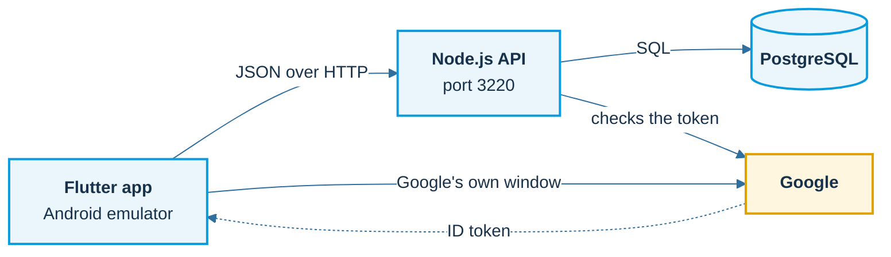

# The Gate: BIP 2026 workshop

A complete, runnable **user authentication system**, built top-down in nine steps:
a **Flutter** app, a **Node.js + Express** API and a **PostgreSQL** database, with sign-in by
**email and password** or by **Google**, **JWT** access tokens, **forgot password** with a one-time code, and
**account linking** for a person who uses both. It runs on your own computer.



The app asks and the server decides. Google proves who the person is once; after that, the API's own tokens carry the session.

## Diagrams

Mermaid diagrams, drawn by GitHub, explain each idea. Start with [docs/README.md](docs/README.md).

| Page | What it shows |
|---|---|
| [Architecture](docs/architecture.md) | the three boxes, the nine steps, inside the API, the data model |
| [JWT and sessions](docs/jwt.md) | what a JWT is, sign and verify, 401 and 403, refresh token rotation |
| [Email and password](docs/password-auth.md) | register, login, forgot password with a one-time code |
| [OAuth and Google](docs/oauth-google.md) | OAuth in one story, the roles, the Google flow, what the server checks |
| [One person, two doors](docs/account-linking.md) | linking Google and a password, why never merge on the email alone |
| [The Flutter app](docs/app.md) | layers, session states, screens, restoring the session |
| [Run it and test it](docs/run-and-test.md) | what `start.sh` does, the checklist, what the tests try |

Something does not work? See the [FAQ](FAQ.md): `createdb: command not found`, `password authentication failed`, a busy port, Google sign-in, and more.

## Run it (one script)

You need Node.js 22+, PostgreSQL, and Flutter with an Android emulator.

```sh
./start.sh        # database + API + emulator + app   (hot reload: r / R / q)
./stop.sh         # stops the app, the API and the emulator that start.sh opened
```

On macOS you can double-click `START-GATE.command` and `STOP-GATE.command` in the course folder instead.
`./start.sh api` starts only the API (http://localhost:3220). The script never resets or drops a database,
creates `api/.env` with a fresh `JWT_SECRET` only if it is missing, and never touches PostgreSQL itself.
Slow emulator? `EMULATOR_ARGS="-gpu host" ./start.sh`. Logs are in `.run/`.

**Forgot password on your own computer:** there is no mail server, so the API prints the email in its log.
Run `./code.sh` to read the newest code. To send real email, put an SMTP address in `SMTP_URL` in `api/.env`.

## The nine steps (the slides follow the same order)

| # | Step | Where | Try it |
|---|---|---|---|
| 1 | Tables | `database/01_users.sql` | `createdb bip_gate && psql bip_gate -f database/01_users.sql` |
| 2 | API skeleton | `api/src/server.js`, `app.js`, `config.js`, `db.js` | `cd api && npm install && npm start`, then `curl localhost:3220/healthz` |
| 3 | Register | `routes/auth.js`, `lib/passwords.js`, `lib/users.js` | `curl -X POST localhost:3220/auth/register …` |
| 4 | Login and the JWT | `lib/tokens.js` | `curl … /auth/login`, then `npm run decode -- <accessToken>` |
| 5 | The keeper | `middleware/requireAuth.js`, `routes/me.js` | `GET /me` 200, `/admin/users` 403, `npm run promote -- you@example.com` |
| 6 | Stay signed in, and forgot password | `database/02_refresh_tokens.sql`, `database/03_password_reset_codes.sql`, `lib/tokens.js`, `lib/reset-codes.js` | refresh once and replay the old token; `forgot-password`, then `./code.sh`, then `reset-password` |
| 7 | Google, and linking | `lib/google.js`, `POST /auth/google`, `POST /auth/google/link` | put the client ID in `api/.env` |
| 8 | The Flutter app | `client/lib`: `models/`, `services/`, `screens/` (sign in, register, forgot password, home) | `./start.sh` |
| 9 | One script | `start.sh`, `stop.sh` | `cd api && DATABASE_URL=postgres://localhost/bip_gate_qa npm test` |

## Design in one page

- **Three tables.** `users` (email, name, Argon2id hash and/or Google subject, role), `refresh_tokens` (SHA-256 hash, absolute expiry, used-at) and `password_reset_codes` (keyed hash, 15-minute expiry, guess counter, used-at).
- **Access token:** a JWT signed with HS256, 15 minutes (`ACCESS_TOKEN_SECONDS`). Claims: `sub`, `role`, `iss`, `aud`, `iat`, `exp`.
- **The role comes from the database** on every protected request, never from the token.
- **Refresh token:** 32 random bytes, 7-day absolute limit, valid once. Reuse deletes all refresh tokens of that user.
- **Logout** deletes the refresh token. An access token already issued works until it expires (15 minutes): that is the price of a token the server does not look up. A sessions table would make it immediate (see the Going further slides).
- **Google:** the app gets an ID token from Google; the API verifies signature, issuer, expiry and audience, requires a verified email and keys the account on Google's `sub`. A Google email that matches a password account is refused with 409 and a hint (no merge on an email match alone).
- **Login** answers the same message and takes the same time for an unknown email and a wrong password. Register, login, Google, forgot and reset are limited to 20 attempts per 15 minutes per address.
- **Forgot password:** a 6-digit one-time code (`crypto.randomInt`), stored as an HMAC, valid 15 minutes, five guesses, one use; one new code per address per minute. `forgot-password` answers the same for every address. A reset deletes the user's refresh tokens. In production the API refuses to start without `SMTP_URL`.
- **One person, two doors.** `users.email` is UNIQUE and a Google user is found by `google_sub`. A person who signed up with a password adds Google after signing in (`POST /auth/google/link`, needs a session and a verified Google token). A person who signed up with Google adds a password through the emailed code. The emailed code is also how the real owner of an inbox takes back an account somebody registered with their address.

## API

| Route | Behaviour |
|---|---|
| `POST /auth/register` | `{name, email, password}` returns normal user + tokens. A submitted role is ignored. |
| `POST /auth/login` | `{email, password}` returns tokens |
| `POST /auth/google` | `{idToken}` returns tokens (503 if `GOOGLE_CLIENT_IDS` is not set) |
| `POST /auth/refresh` | `{refreshToken}` returns a new pair; the old token stops working |
| `POST /auth/logout` | `{refreshToken}` returns 204 |
| `POST /auth/forgot-password` | `{email}` returns the same 200 message for every address; a code is emailed (printed in the log without `SMTP_URL`) |
| `POST /auth/reset-password` | `{email, code, password}` returns 200, the password changes and every refresh token of the user is deleted; any failure: 400, one message |
| `POST /auth/google/link` | signed in + `{idToken}` returns the user, who now has both ways in (409 if Google is already linked or belongs to someone else) |
| `GET /me` | the signed-in user, with `methods`: `["password"]`, `["google"]` or both |
| `GET /admin/users` | admins only (403 for everyone else) |
| `GET /healthz` | database-backed readiness |

## Google sign-in (optional)

1. In Google Cloud create a project, the consent screen (External, Testing, add yourself as a test user) and an OAuth client of type **Web application**.
2. Put its client ID in `api/.env`: `GOOGLE_CLIENT_IDS="<id>.apps.googleusercontent.com"`. It is a public identifier, not a secret.
3. For Android, add a second OAuth client of type **Android**: package `com.example.gate_client` and the SHA-1 of your signing key
   (`keytool -list -v -keystore ~/.android/debug.keystore -alias androiddebugkey`, password `android`).
4. `./start.sh` passes the same web client ID to the app as `--dart-define=GOOGLE_WEB_CLIENT_ID=…`. Use an emulator image with Google Play and sign in to a Google account in it.

The Google sign-in itself needs your own account and an interactive window, so the automated tests replace Google's signature check with a stub.

## Tests

```sh
createdb bip_gate_qa
cd api    && DATABASE_URL=postgres://localhost/bip_gate_qa npm test      # 20 tests: tokens, roles, refresh, Google rules, reset codes, linking
cd client && flutter analyze && flutter test                             # 15 tests: claims, errors, refresh once, forgot password screens
```

The API tests forge, expire, re-sign, strip and replace the algorithm of tokens, replay a refresh token, race two refreshes, and check that a Google email never merges into a password account, that a reset code dies after five guesses, expires, works once and signs the person out everywhere, and that Link Google needs a session.

## What this workshop leaves out on purpose

Email verification at registration (the step that would make merging by email safe), change password for a signed-in person, alerts by email, MFA and passkeys, an audit log, per-device session lists, immediate revocation of access tokens, and a production deployment (HTTPS, secrets management, a proxy and `trust proxy`). The slides in the Going further section explain each one.

## References

- [Google: verify an ID token on the backend](https://developers.google.com/identity/sign-in/web/backend-auth)
- [google_sign_in](https://pub.dev/packages/google_sign_in) · [flutter_secure_storage](https://pub.dev/packages/flutter_secure_storage)
- [OAuth 2.0 Security Best Current Practice, RFC 9700](https://www.rfc-editor.org/rfc/rfc9700.html)
- [OWASP Password Storage Cheat Sheet](https://cheatsheetseries.owasp.org/cheatsheets/Password_Storage_Cheat_Sheet.html)

Bundled Noto Sans fonts are under the SIL Open Font License (`client/assets/fonts/`).
