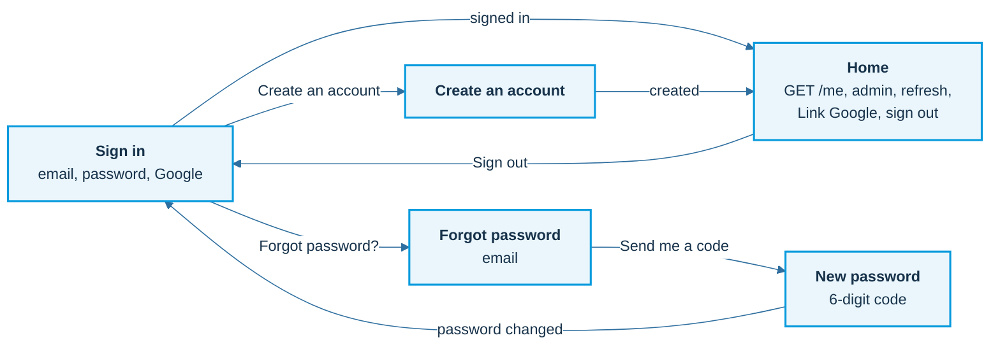

# The Gate: Flutter client

A sign-in app: email + password or Google, JWT from the Node API, refresh token in secure storage.
Runs on the Android emulator (and the iOS simulator). From the workshop folder, `./start.sh` does everything below for you.

## Run by hand

```sh
cd client
flutter pub get
flutter run -d emulator-5554 --no-enable-impeller \
  --dart-define=API_URL=http://10.0.2.2:3220 \
  --dart-define=GOOGLE_WEB_CLIENT_ID=<web-client-id>.apps.googleusercontent.com
```

| Define | Meaning | Default |
|---|---|---|
| `API_URL` | Where the API listens. `10.0.2.2` is the emulator's name for your computer. | `http://10.0.2.2:3220` on Android, `http://localhost:3220` elsewhere |
| `GOOGLE_WEB_CLIENT_ID` | The **Web** OAuth client ID from Google Cloud (public). Empty: the Google button is disabled. | empty |

Checks: `flutter analyze` and `flutter test` (unit tests, no device needed).

## How the screens connect



More diagrams (layers, session states, restoring the session, one refresh at a time): [docs/app.md](../docs/app.md).

## File map (same shape as the course diagram: Models, Services, Screens)

```
lib/main.dart                      app + AuthGate (splash -> login or home, decided by the session)
lib/config.dart                    API_URL, GOOGLE_WEB_CLIENT_ID
lib/models/user.dart               who you are (id, email, name, role, methods)
lib/models/auth_session.dart       what sign-in returns (two tokens + user)
lib/models/access_token_claims.dart  decodes the readable middle of a JWT
lib/services/api_service.dart      every REST call; one retry after 401 with one shared refresh
lib/services/session_manager.dart  the tokens: access in memory, refresh in secure storage
lib/services/google_service.dart   "Sign in with Google" -> ID token
lib/screens/                       splash, login, register, forgot password, new password, home
test/                              claim decoding, error parsing, refresh behaviour, forgot password screens
```

Android package: `com.example.gate_client` (registered with the Google Android OAuth client; do not rename it).
Debug builds may use plain HTTP to 10.0.2.2 / localhost only (`android/app/src/debug/res/xml/network_security_config.xml`); release builds are HTTPS-only.
