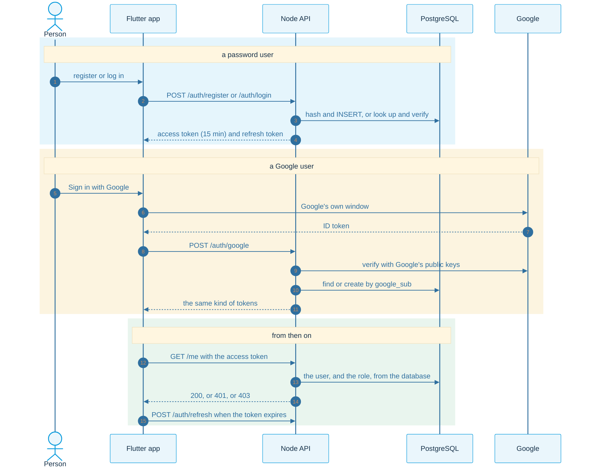

# Diagrams

Every page here explains one idea with [Mermaid](https://mermaid.js.org/) diagrams, which GitHub draws for you. They follow the order of the nine steps.

| Page | What it shows | Steps |
|---|---|---|
| [architecture.md](architecture.md) | the three boxes, the nine steps, inside the API, the data model, the folders | 1, 2 |
| [jwt.md](jwt.md) | what a JWT is, sign and verify, 401 and 403, access and refresh tokens, rotation and replay | 4, 5, 6 |
| [password-auth.md](password-auth.md) | register, login, forgot password with a one-time code, the reset code's life | 3, 4, 6 |
| [oauth-google.md](oauth-google.md) | OAuth in one story, the roles, the Google flow, what the server checks, the console setup | 7 |
| [account-linking.md](account-linking.md) | one person with two doors, linking, why never merge on the email alone | 7 |
| [app.md](app.md) | the Flutter layers, the session states, the screens, restoring the session, one refresh at a time | 8 |
| [run-and-test.md](run-and-test.md) | what `start.sh` does, the checklist, what the tests try | 9 |

## The whole system in one picture

