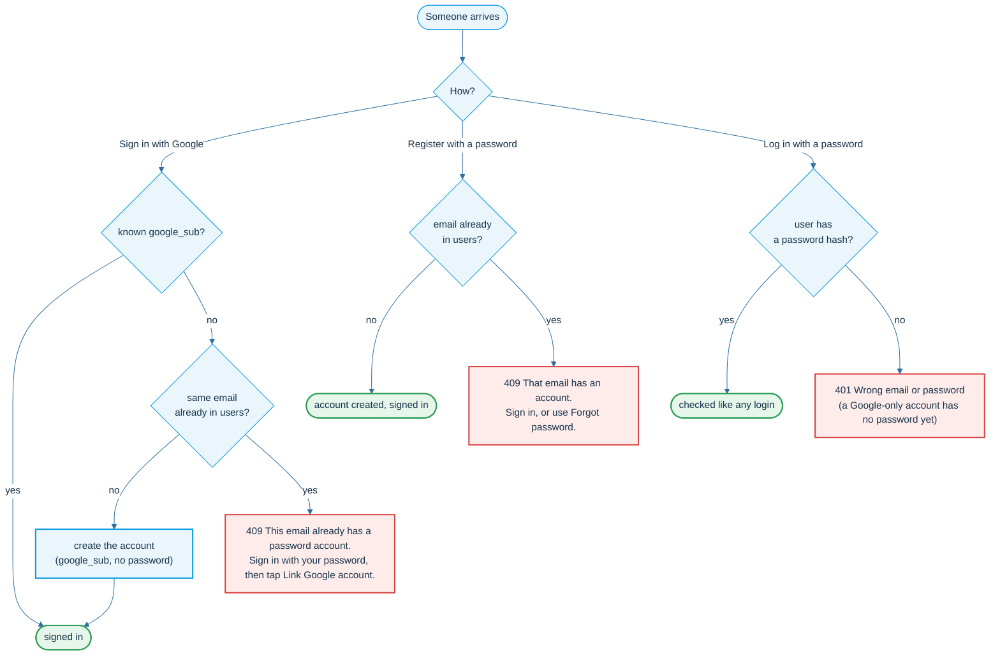
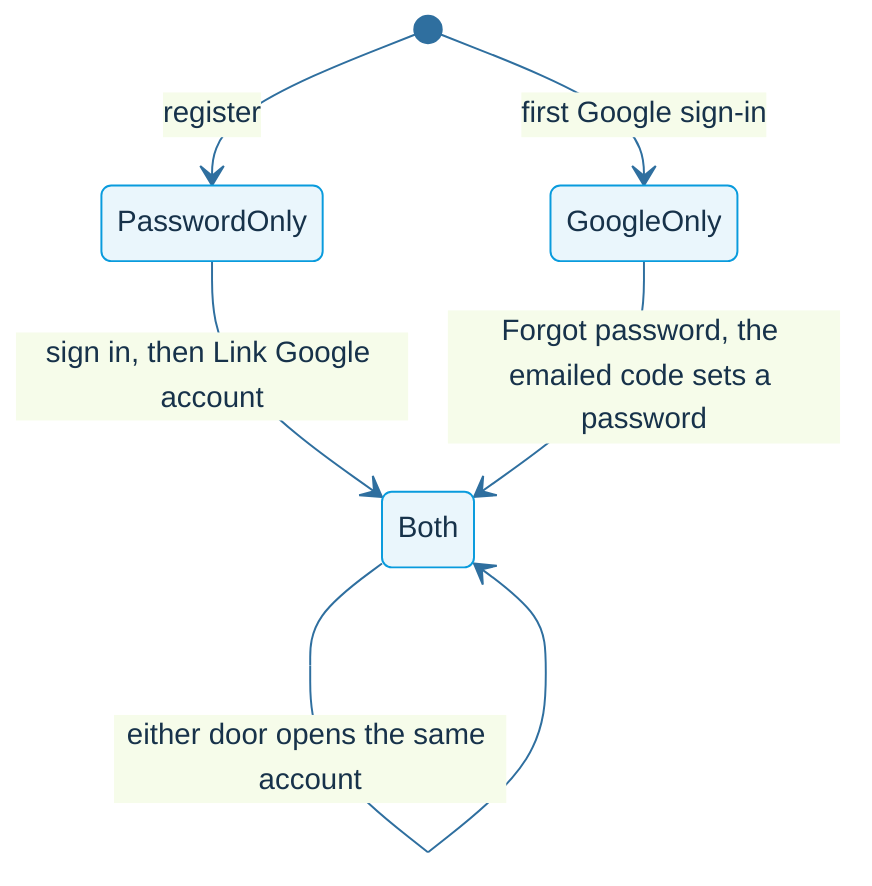
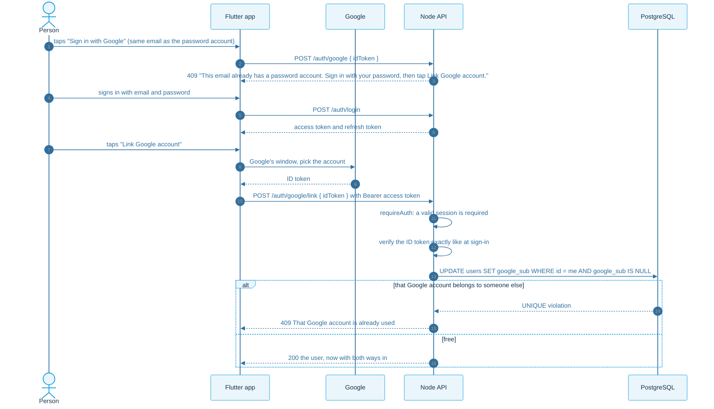
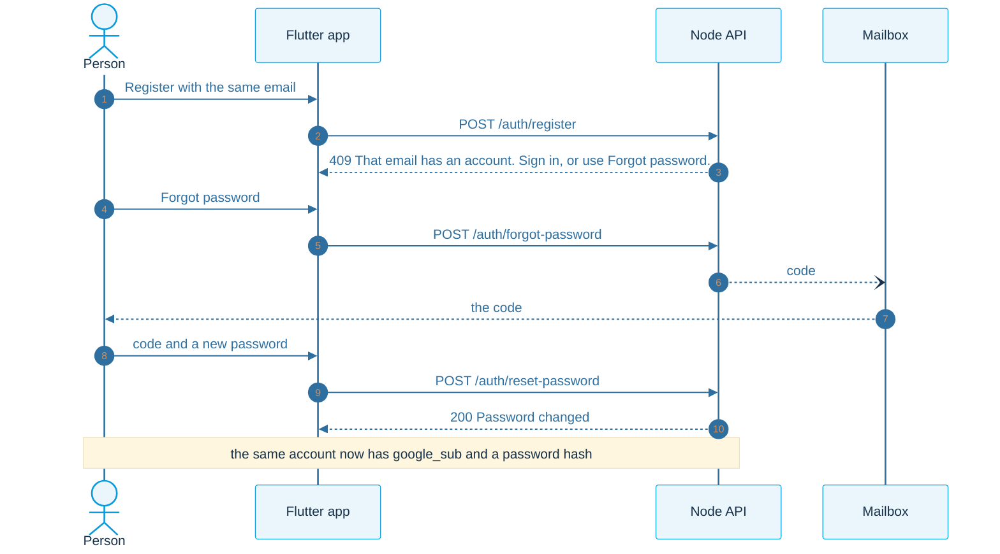
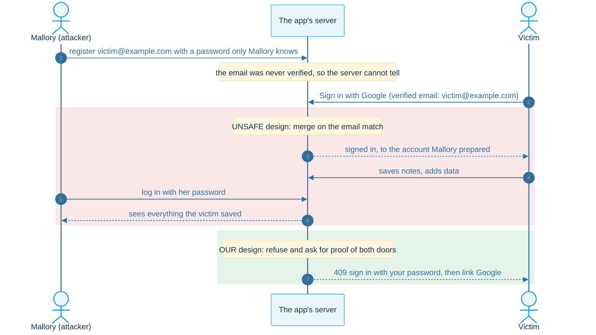
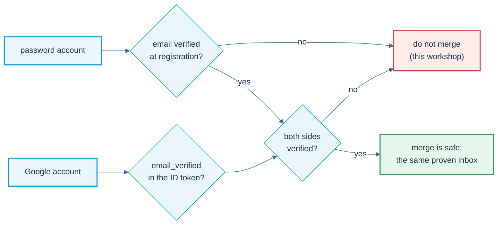

# One person, two doors

What happens when the same person arrives by both doors: once with a password, once with Google.

**The rules:** one email, one account. A Google user is found by Google's subject (`google_sub`). The two doors are joined only with proof of both, and **never because two emails look the same**.

## Who arrives how

## Ways in, and how an account gets a second one

The home screen of the app shows the ways in: `password`, `google`, or both.

## Password first, then Google: link it

The person proves the password (they hold a session) **and** Google (the token). Only then is `google_sub` written on that account.

## Google first, then a password: use the emailed code

The code proves the inbox, so it can safely add a password to a Google-only account.

## Why we never merge on the email alone

Anyone can register with any address. We have not checked that the inbox is theirs. This attack has a name: **pre-account hijacking**.

The emailed code also settles the squatting case: the real owner can always take the account back, because only they can read the inbox, and the reset ends every session of the squatter.

## What would make an automatic merge safe

