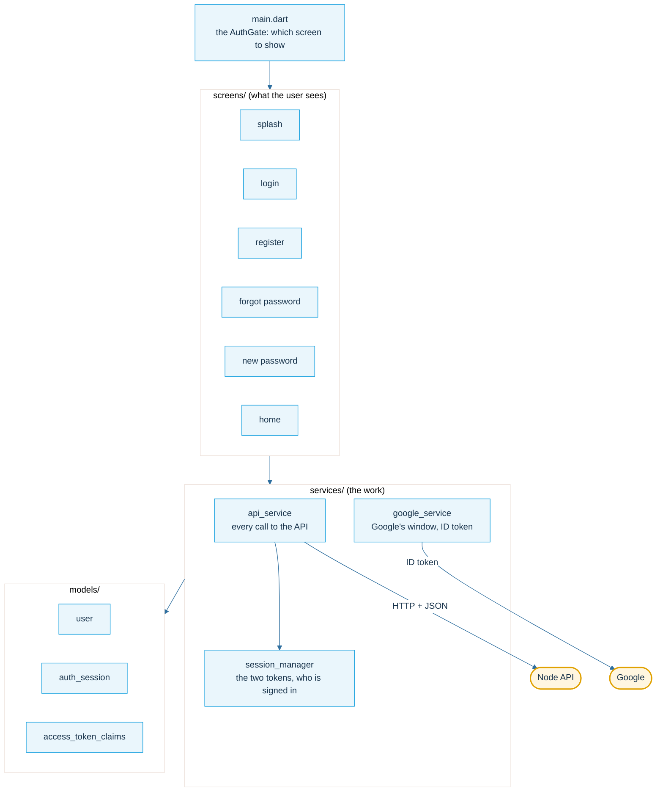
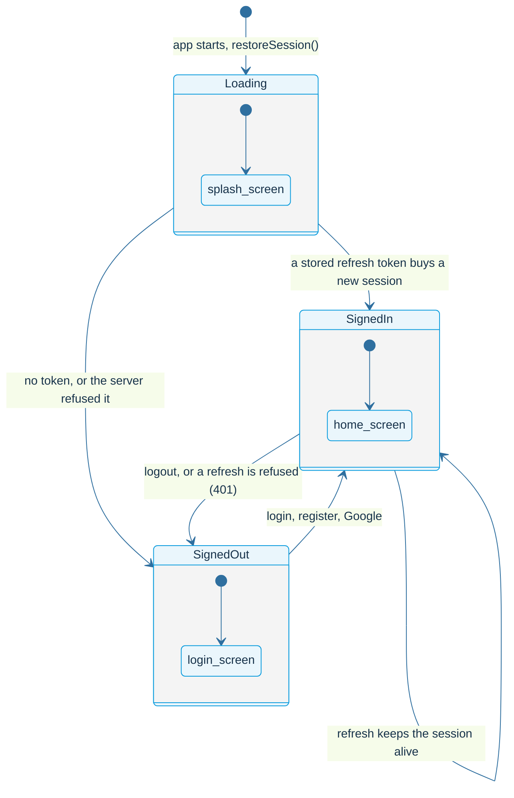
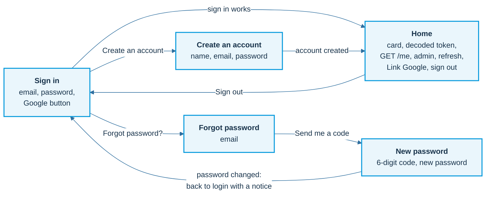
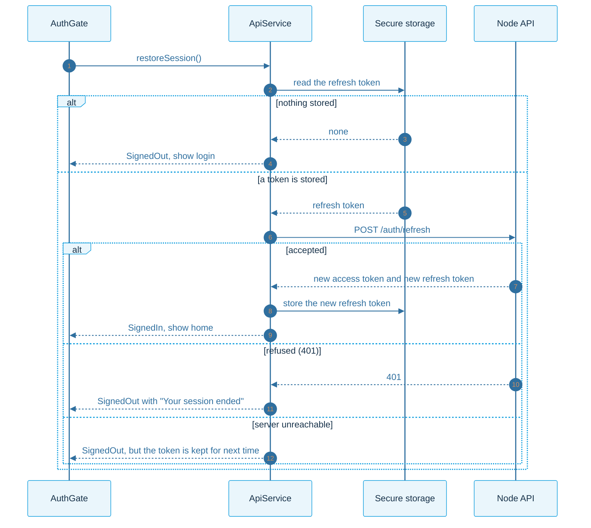
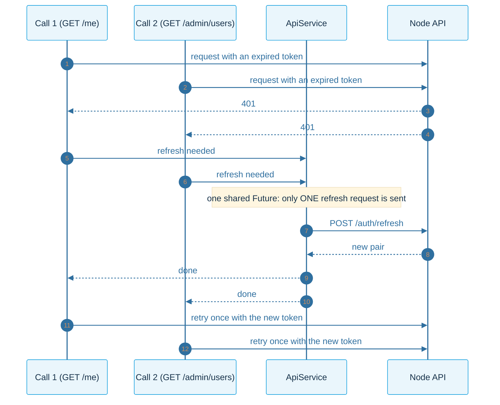
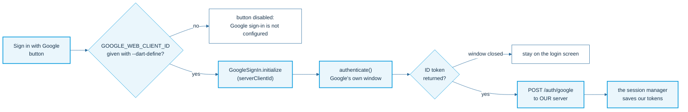
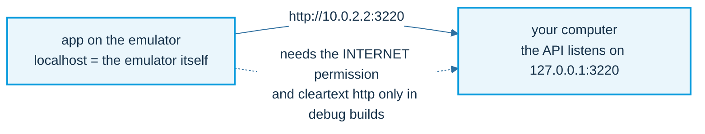

# The Flutter app

The app holds the pass and shows it. It has no secrets and makes no decisions: the server decides.

## Layers

Three folders, one idea per file. Screens show state and call services; services call the API; models describe what the API sends.

## Which screen to show

The AuthGate in `main.dart` looks only at the session. Nothing else decides.

## Screens and how they connect

## Starting the app: restore the session

The access token lives in memory only, so it is gone when the app closes. The refresh token waits in secure storage (Android Keystore, iOS Keychain).

## One refresh at a time

Several calls can fail at the same moment with an expired access token. They share one refresh request, then each retries once.

## Sign in with Google (Flutter side)

## Talking to the emulator's host

