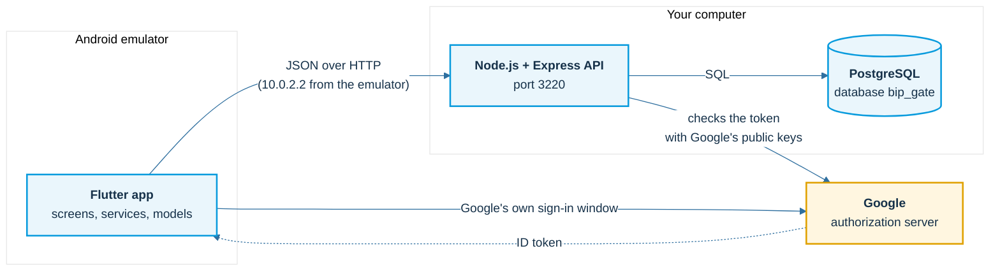
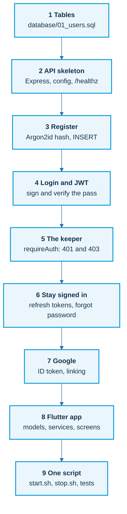
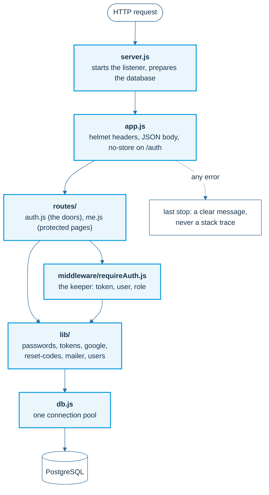
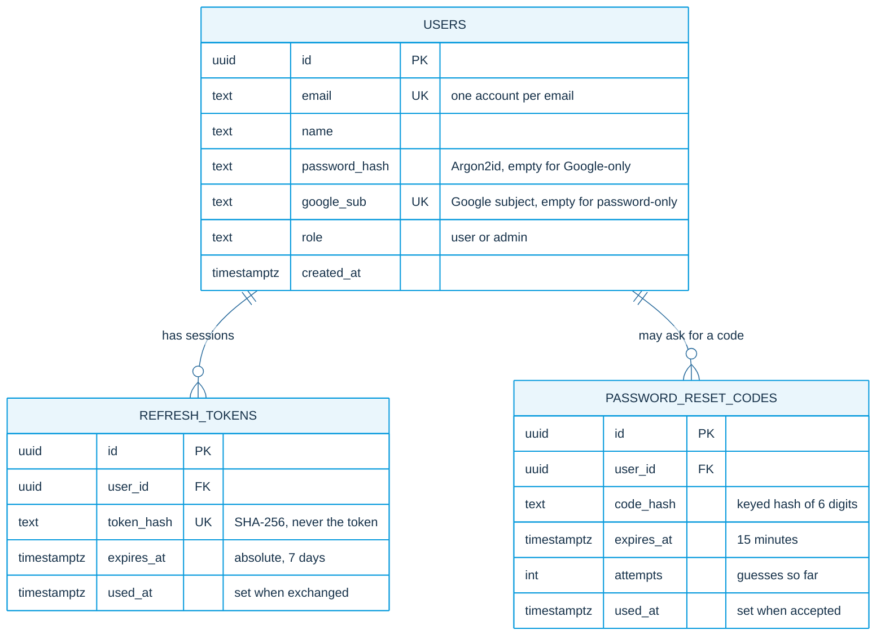
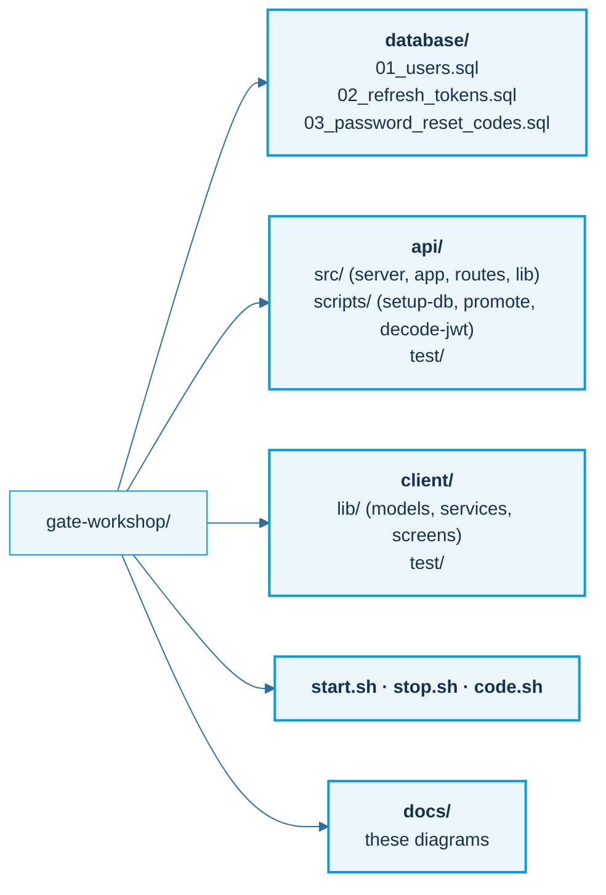

# Architecture

The whole system in a few pictures. Every diagram here is drawn from the real code in this repository.

## The three boxes

One rule: **the app asks, the server decides.** The app holds a pass and shows it; only the API and the database decide who may do what.

## The nine steps

Top-down: the plan first, then the database, then the API, then the app. Every step ends with something you run.

## Inside the API

Small files, one job each. A request travels from the top to the bottom and back.

## Data model

Three tables. Nothing secret is stored in clear text: passwords and tokens are hashes.

A database rule keeps every user reachable: a row must have a password hash, a Google subject, or both (`has_a_sign_in_method`).

## What lives where

