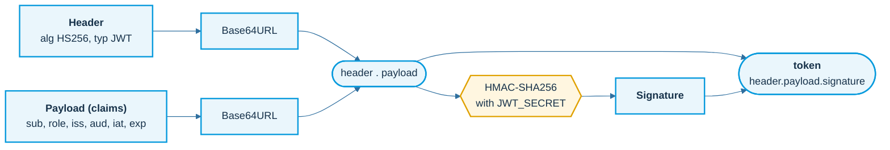
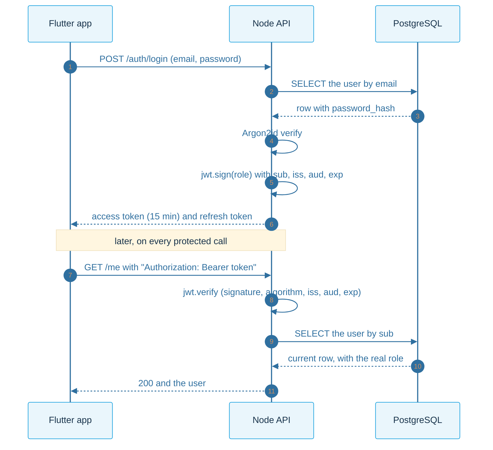
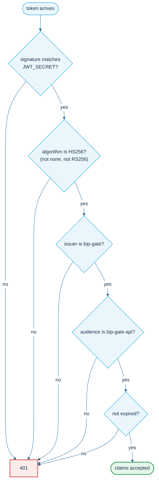
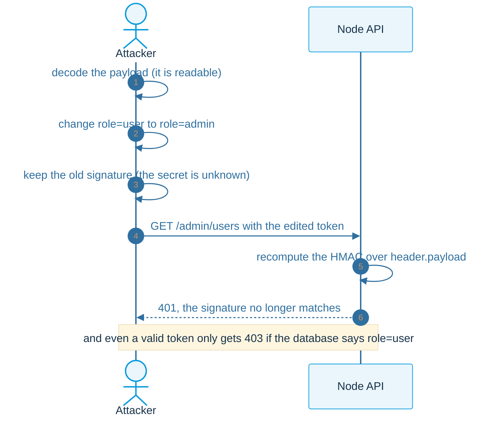
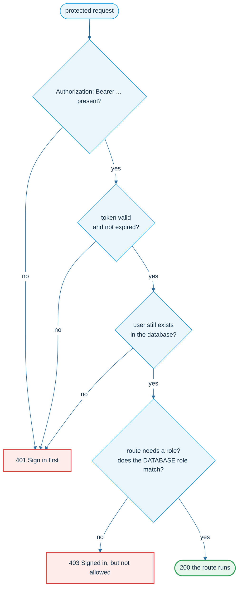
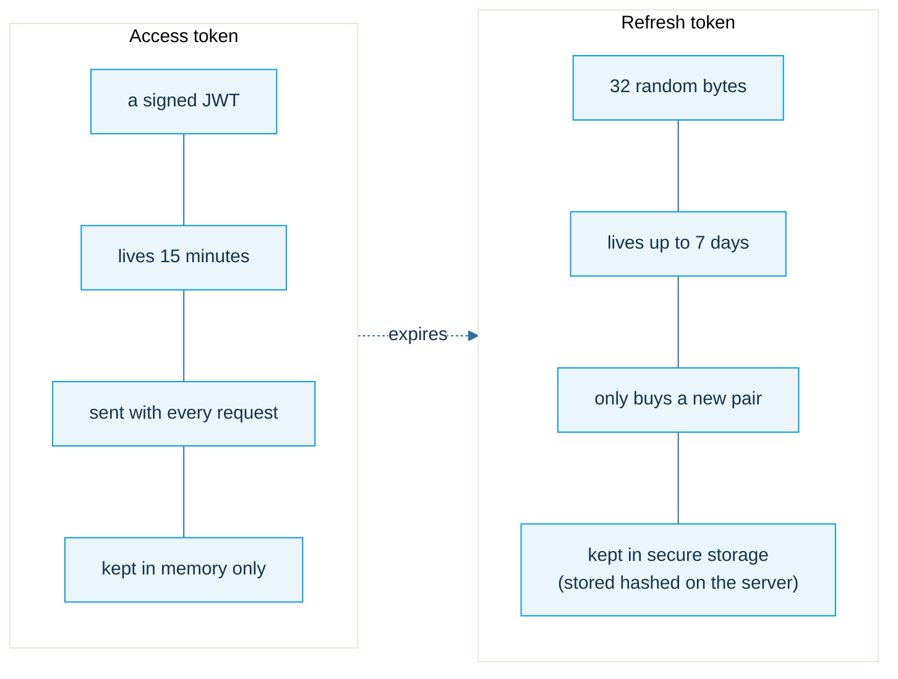
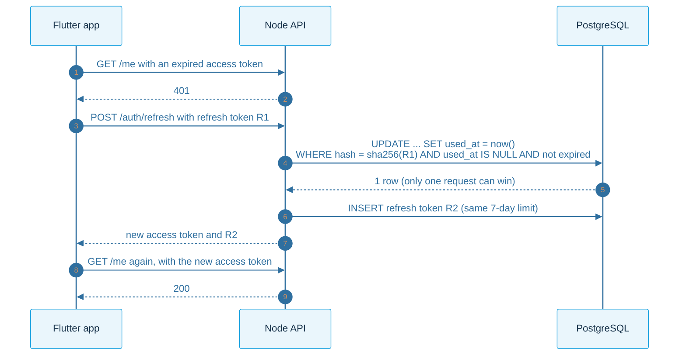
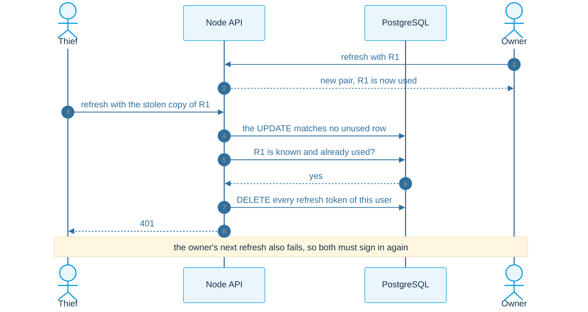
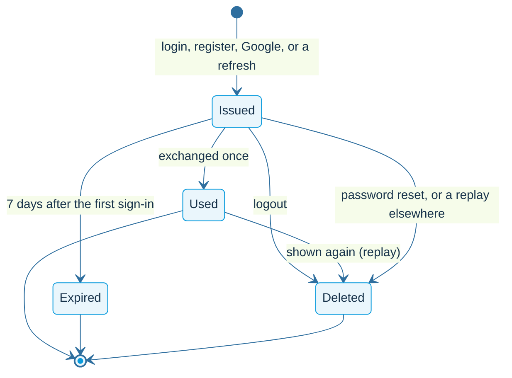

# JWT and sessions

How the pass works: what is inside it, how the server seals and checks it, and how a session stays alive.

## What a JWT is

Three parts, separated by dots. The first two are only **encoded**: anyone can read them. The third is a **signature** that only the server can make.

| Claim | Meaning | Our value |
|---|---|---|
| `sub` | who the token is about | the user's id |
| `role` | a convenience copy of the role | `user` or `admin` (the server never trusts it) |
| `iss` | who issued it | `bip-gate` |
| `aud` | who it is for | `bip-gate-api` |
| `iat`, `exp` | issued at, expires at | 15 minutes apart |

## Sign at login, verify on every request

## What verify checks

One call checks everything at once. The token does not get to choose its own algorithm: the server decides.

## Change one claim, break the seal

## The keeper: 401 and 403

Two different refusals. **401**: the keeper does not know who you are. **403**: the keeper knows exactly who you are, and the answer is still no.

## Two tokens, two jobs

## Refresh token rotation

Each refresh token works exactly once. A new access token comes with a new refresh token.

## A spent token comes back

If an already-used refresh token is shown again, a copy was stolen. We sign the person out everywhere.

## Life of a refresh token

## What logout cannot do

Logout deletes the refresh token on the server and the app forgets its copy. The access token already issued lives until it expires (at most 15 minutes): that is the price of a pass the server does not look up. A sessions table would make revocation immediate.
