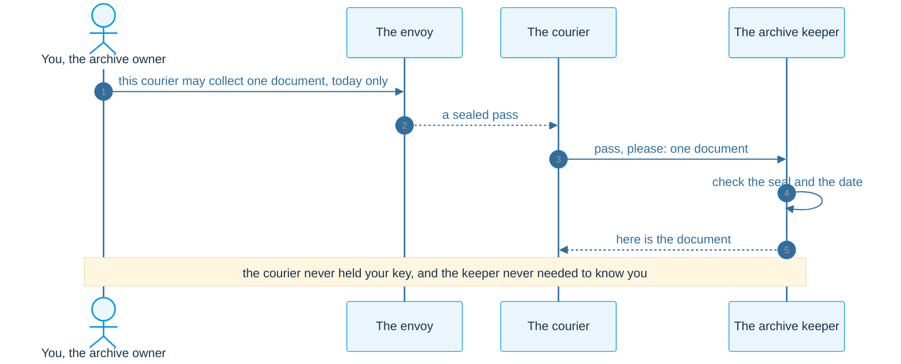
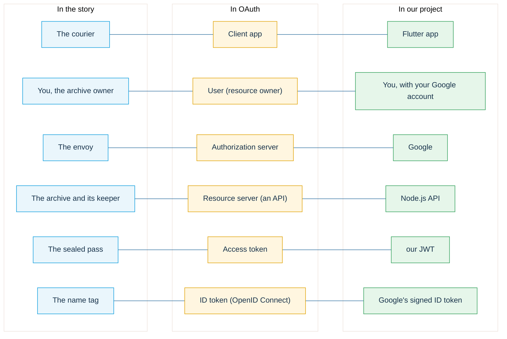
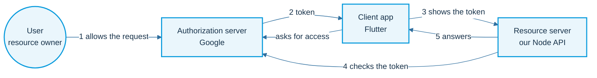
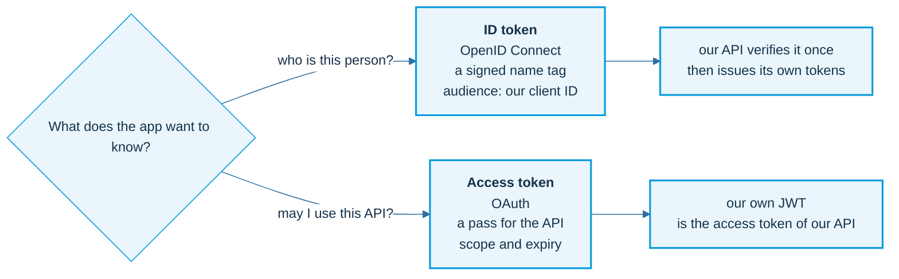
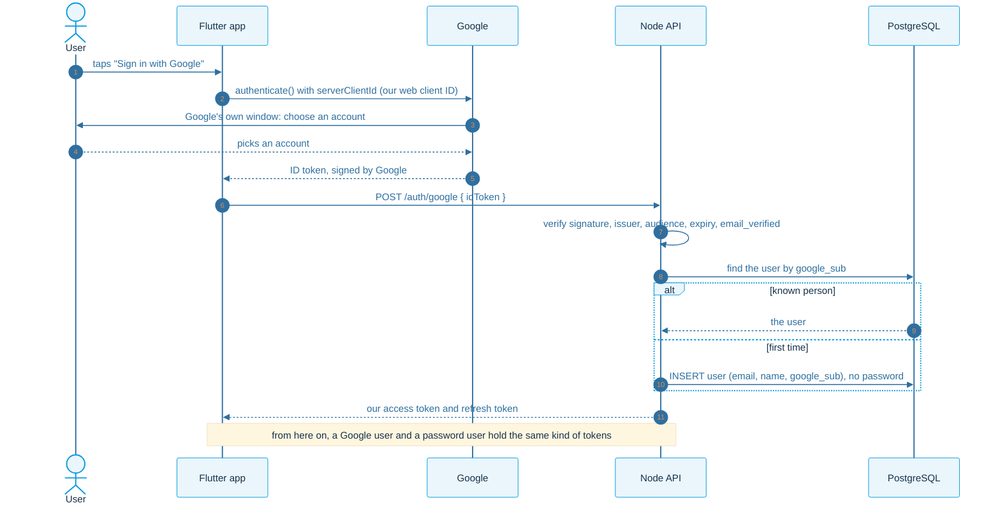
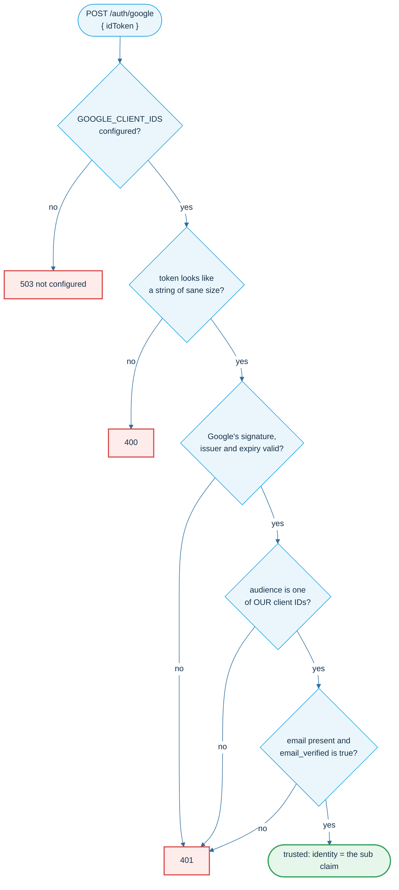
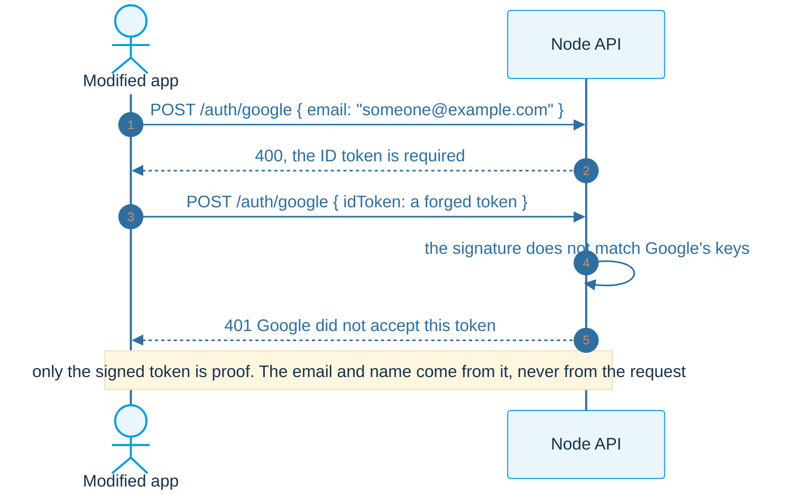
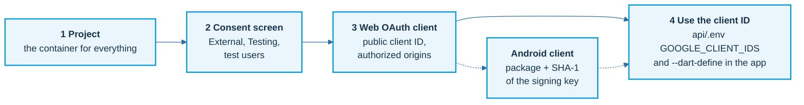

# OAuth and Sign in with Google

The idea first, in a short story. Then the real names, then the real flow in our app.

## OAuth in one story: the archive

A locked archive holds your documents and only you have the key. A courier offers to fetch one document. You do not hand over your key: you ask the envoy, whom everyone trusts, to give the courier a sealed pass for that one document, today only.

## The same story, with real names

## The OAuth roles

Four protections come with every token: the password stays with Google, the token has a **scope** (only what was allowed), an **expiry**, and it can be **revoked**.

## Access token and ID token

## Sign in with Google, step by step

Google proves who the person is **once**. After that, our own tokens carry the session.

## What the server checks on the ID token

The audience check matters: a token that Google issued to a **different** app proves nothing about someone signing in to ours.

## Why the app never decides who the user is

## The Google Cloud setup, in four stops

