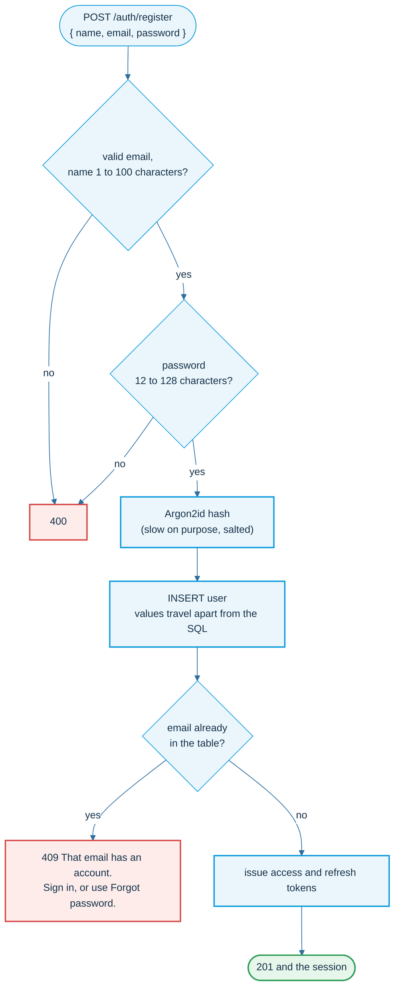
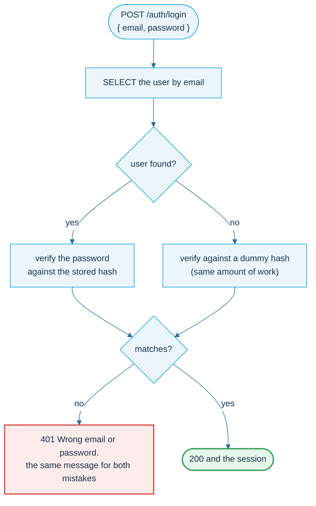
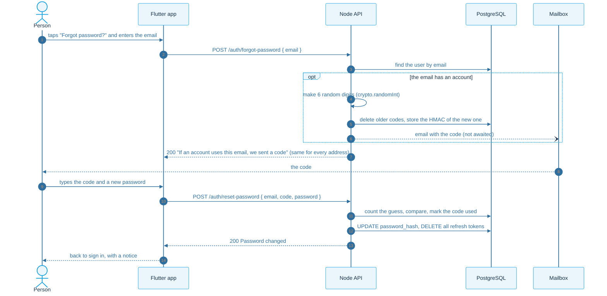
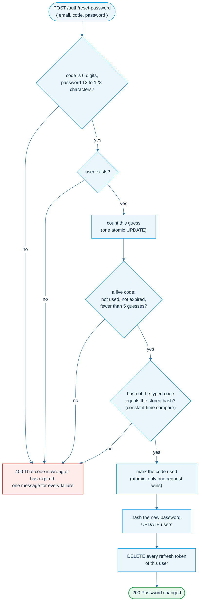
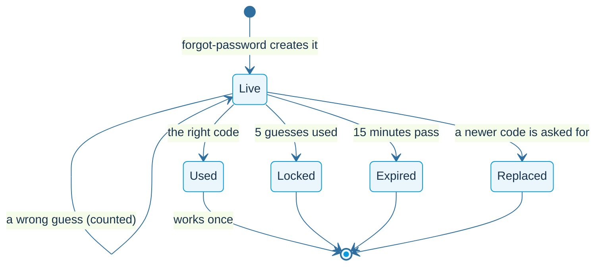
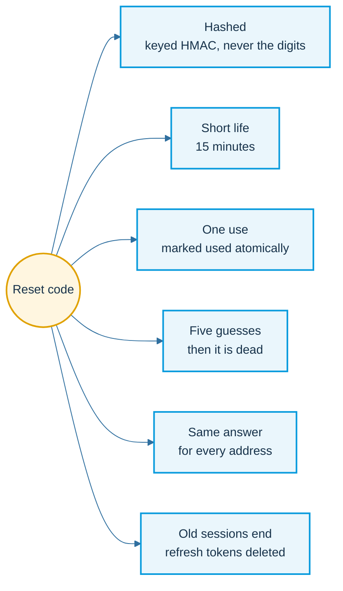

# Email and password

Register, log in, and get back in when the password is forgotten. For people who do not want, or cannot use, Google.

## Register

Validate first, hash the password, then one INSERT. The client can never choose its own role: the column default decides.

## Login: one message for two mistakes

An unknown email and a wrong password look identical, in text and in time.

A Google-only account has no hash, so the password door stays shut for it: it gets the same 401.

## Forgot password: the one-time code

Whoever can read the inbox of the account may set a new password, so the code is treated like a password that exists for 15 minutes.

On your own computer there is no mail server: the API prints the email in its log and `./code.sh` shows the newest code. Set `SMTP_URL` in `api/.env` to send real email.

## Checking the code

## Life of a reset code

## The six rules

Access tokens already issued stay valid until they expire (at most 15 minutes). That is the same honest cost as with logout.
