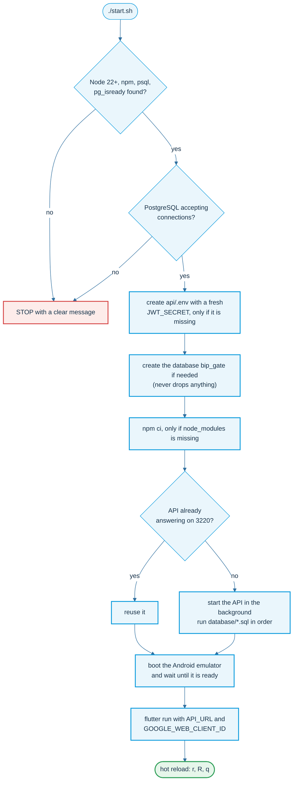
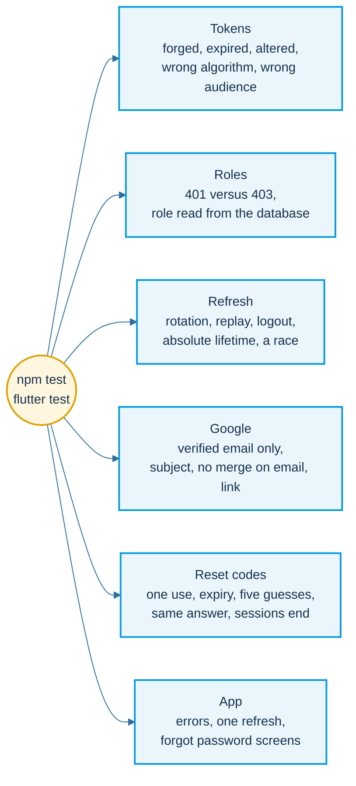

# Run it and test it

One script starts everything, one script puts it out.

## What start.sh does



`./stop.sh` stops the app, the API and the emulator that `start.sh` opened. It never touches PostgreSQL.
`./code.sh` prints the newest forgot-password code, because the API prints the email in its log.

## Try the whole system


## What the tests try

The tests run on their own database, never your real one. They try the doors the wrong way.



```sh
createdb bip_gate_qa
cd api    && DATABASE_URL=postgres://localhost/bip_gate_qa npm test
cd client && flutter analyze && flutter test
```
